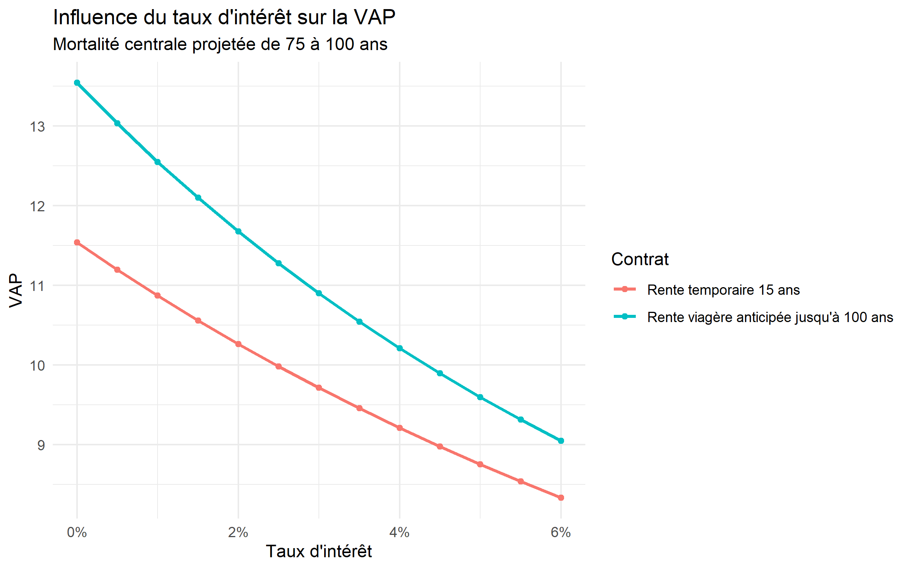
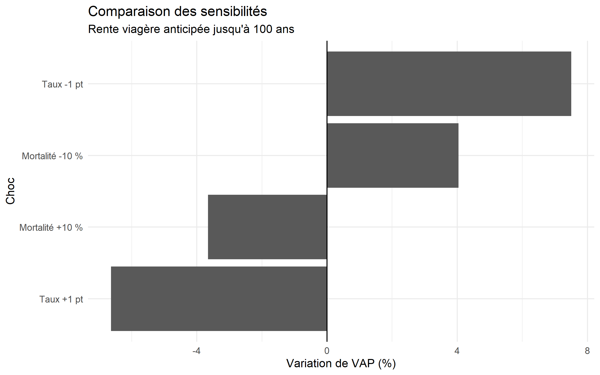
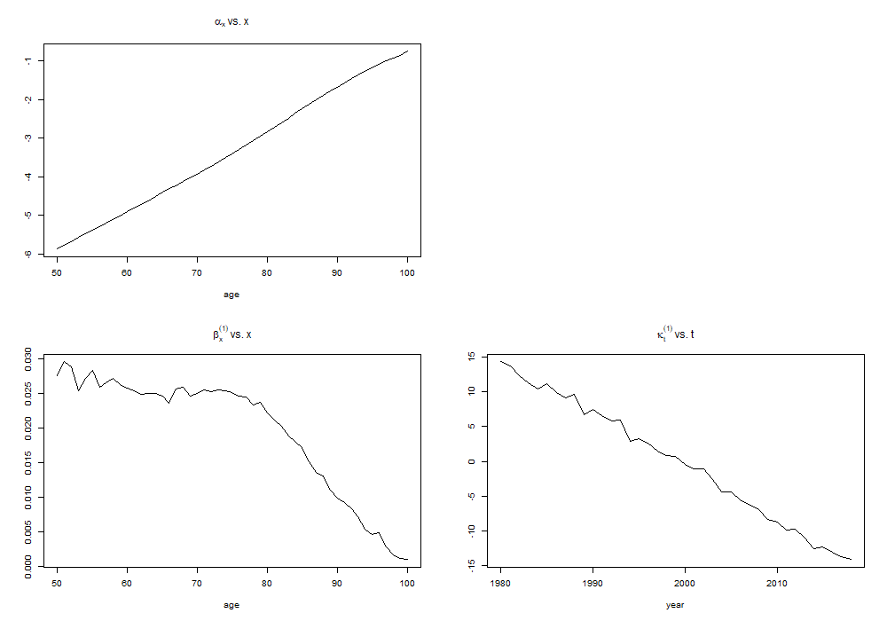

# Life Annuity Valuation under Interest-Rate and Longevity Risk

**Stochastic mortality (Lee-Carter) · Actuarial present value · Sensitivity analysis · R / StMoMo**

How sensitive is the value of a life annuity to interest rates, compared with mortality? This project values a life annuity sold in 2018 to a cohort of 75-year-old Swedish policyholders. Mortality is projected with a Poisson Lee-Carter model fitted on Human Mortality Database data, and the annuity value is stress-tested against interest-rate and longevity shocks.

> Life Insurance Actuarial Science project, M1 Actuarial Management and Mathematical Modelling (ESB, Tunisia), dual degree with Le Mans University. Full report and code are in French.

---

## Key results

Central scenario: flat rate of 2%, unit annuity-due, cohort born in 1943, ages 75 to 100.

| Contract | Expected present value |
|---|---|
| Whole-life annuity-due (75 → 100) | **11.67** |
| 15-year temporary annuity-due (75 → 89) | **10.26** |

| Shock on the whole-life annuity | Change in value |
|---|---|
| Interest rate −1 pt | **+7.50 %** |
| Interest rate +1 pt | **−6.64 %** |
| Mortality −10 % | +4.04 % |
| Mortality +10 % | −3.65 % |
| Mortality −20 % (size of the Solvency II standard-formula longevity shock) | **+8.54 %** |

- **Effective duration ≈ 7.1 years:** the annuity loses about 7% of its value for every 1-point rise in rates. The response is asymmetric (+7.5% vs −6.6%), which reflects positive convexity.
- **Which risk dominates depends on how the shocks are calibrated.** A ±1 pt rate shock moves the value more than a ±10% mortality shock. A −20% mortality shock, the size of the Solvency II longevity stress, moves it more than the rate shock.
- **Longevity risk is concentrated at old ages.** Age-differentiated shocks change the whole-life annuity 2–2.5 times more than the 15-year temporary annuity.
- **The model is robust to calibration choices.** Changing the Lee-Carter calibration window (1970, 1980 or 1990 to 2018) changes the value by at most 0.2%. Extending the payment horizon from 100 to 110 adds only 0.2%.

<p align="center">
  
  
</p>
<p align="center">
  
</p>

---

## Methodology

1. **Data:** Swedish deaths, exposures and central death rates (HMD, 1×1 format, both sexes combined).
2. **Cohort mortality:** the 1943 cohort is extracted with `StMoMo::extractCohort`. Death rates are estimated by Poisson maximum likelihood ($\hat m_x = D_x / E_x$), with 90% confidence intervals built on the log scale.
3. **Mortality projection:** a Poisson log-bilinear Lee-Carter model (Brouhns, Denuit & Vermunt, 2002),

   $$\log m_{x,t} = a_x + b_x k_t$$

   fitted on ages 50–100 and years 1980–2018, then projected to complete the cohort up to age 100.
4. **Valuation:** annuity-due present values

   $$\ddot a_{75} = \sum_{k \ge 0} v^k \, {}_k p_{75}, \qquad v = \frac{1}{1+i}$$

   for a whole-life annuity and a 15-year temporary annuity.
5. **Sensitivity and robustness:** a rate grid from 0% to 6%; uniform and progressive mortality shocks (factor 0.80 to 1.20); age-differentiated shocks; alternative calibration windows; alternative terminal ages.

## Limitations and possible extensions

- The flat discount rate could be replaced by a risk-free yield curve, such as the EIOPA curve.
- The Lee-Carter projection is deterministic. Simulating $k_t$ would give a distribution of the annuity value instead of a single figure.
- Population mortality (both sexes) is used instead of annuitant mortality, so selection effects are not captured.
- Other stochastic mortality models (CBD, APC) could be compared with Lee-Carter.

## Repository structure

```
analyse_rente_viagere.Rmd   Full R Markdown analysis (French)
Figures/                    Charts used in the report
Resultats/                  Result tables (CSV)
rapport/                    Report (PDF, 29 pages) and presentation slides
data/                       HMD files: not redistributed, see data/README.md
```

## Reproduce

1. Download the Swedish `Mx_1x1.txt`, `Deaths_1x1.txt` and `Exposures_1x1.txt` files from [mortality.org](https://www.mortality.org/) (free registration) into `data/`.
2. Install the packages: `install.packages(c("StMoMo", "ggplot2", "dplyr", "tidyr", "scales"))`
3. Knit `analyse_rente_viagere.Rmd` from the repository root.

A video presentation of the project (in French) is available [here](https://youtu.be/tNpSYDIIklI).

## References

- Lee, R. D. & Carter, L. R. (1992). *Modeling and forecasting U.S. mortality.* JASA, 87(419).
- Brouhns, N., Denuit, M. & Vermunt, J. K. (2002). *A Poisson log-bilinear regression approach to the construction of projected lifetables.* IME, 31(3).
- Villegas, A. M., Kaishev, V. K. & Millossovich, P. (2018). *StMoMo: An R package for stochastic mortality modelling.* JSS, 84(3).
- Human Mortality Database. University of California, Berkeley and Max Planck Institute for Demographic Research.

---

**Ghalia Ben Zakour**, actuarial science student, M2 Actuarial Science and Data Science (ESB / Le Mans University)
