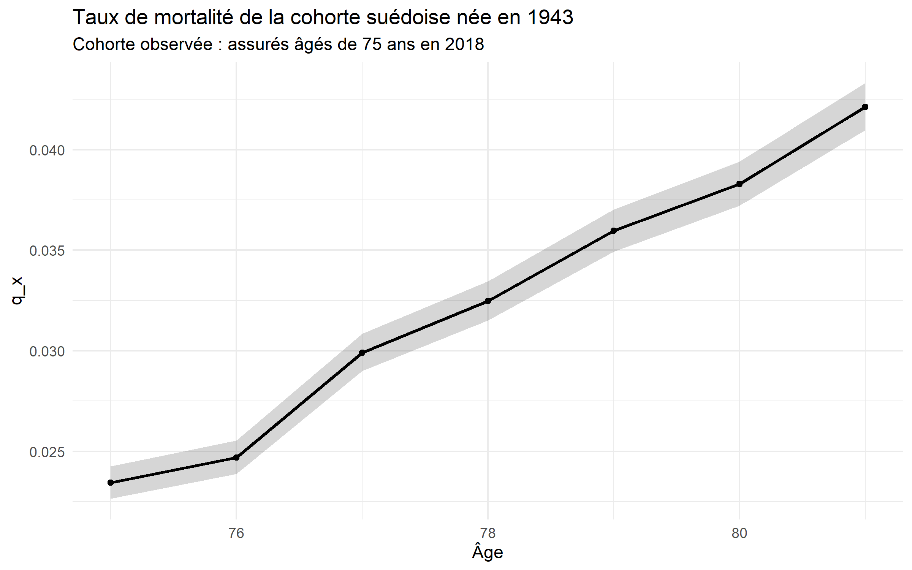
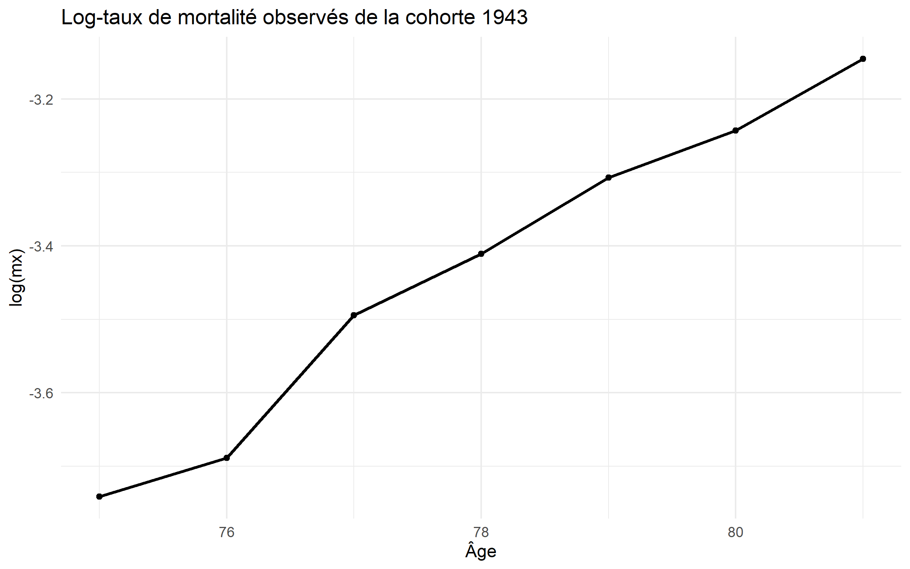
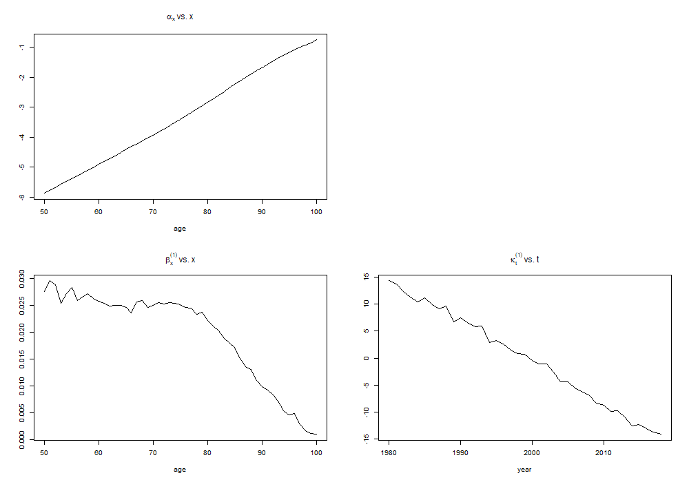
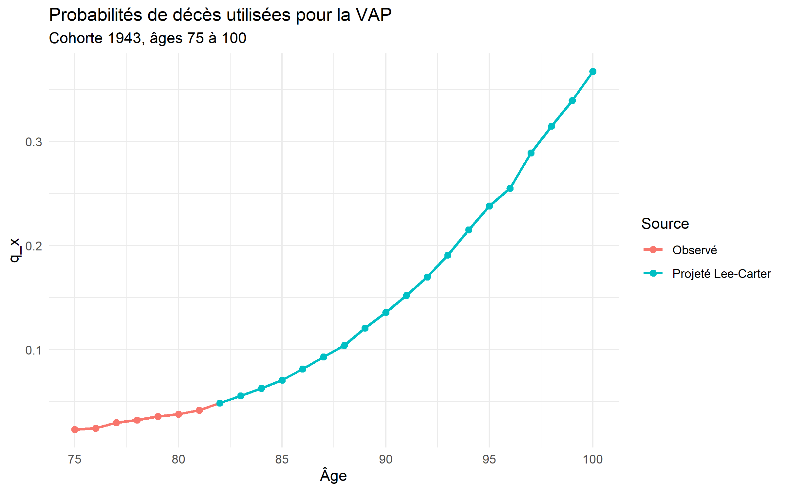
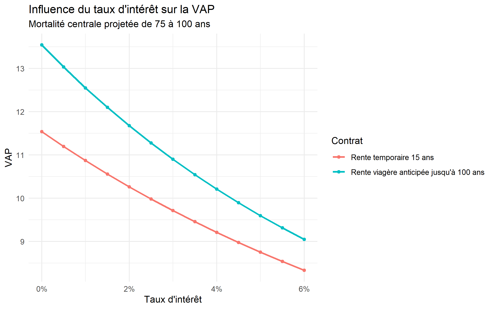
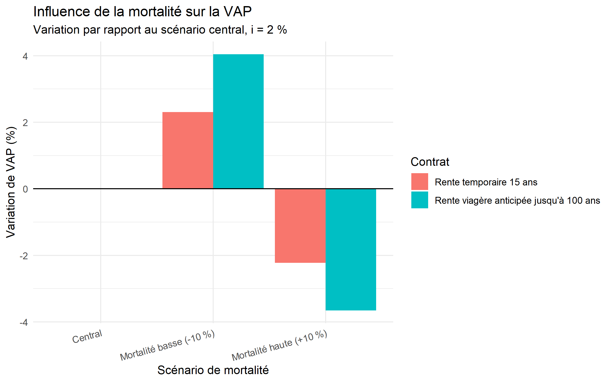
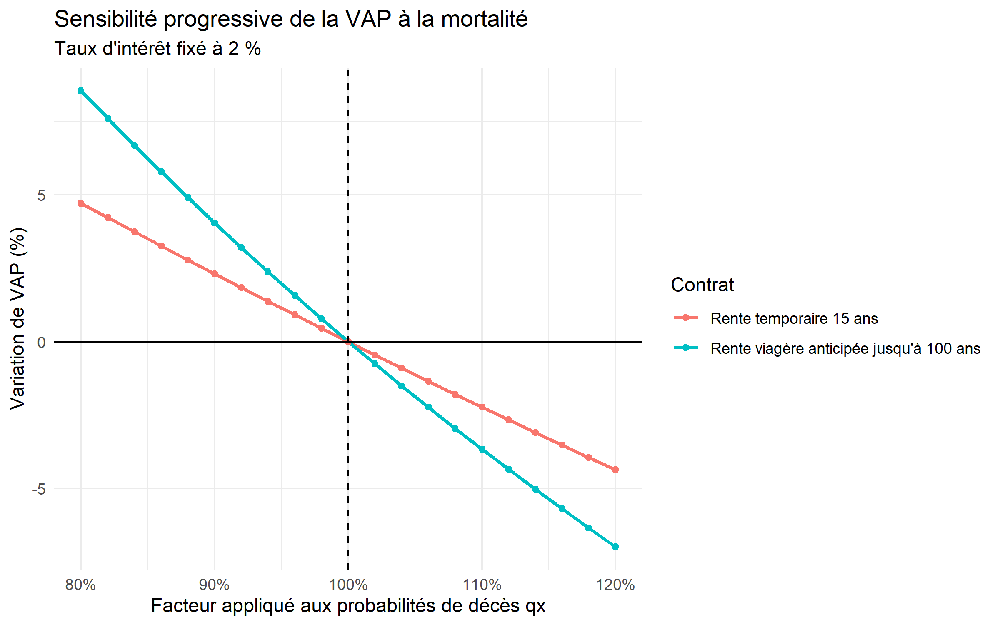
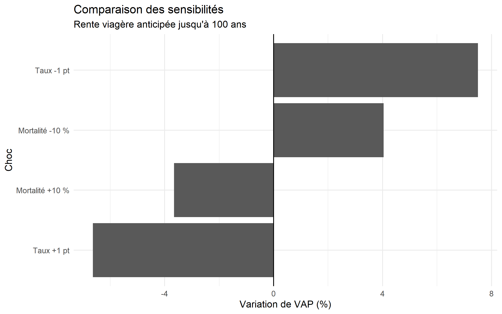
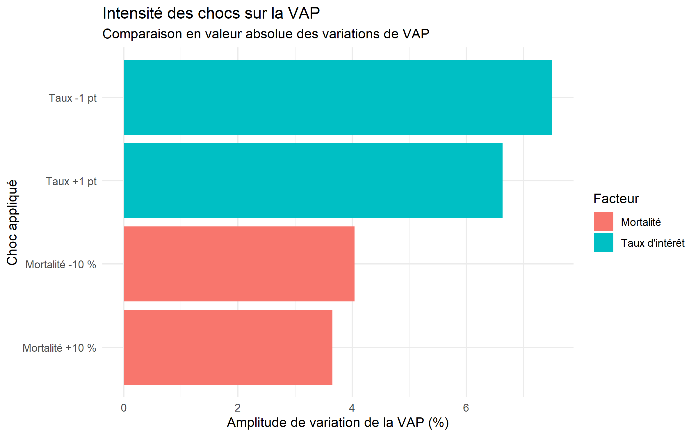

```{r setup, include=FALSE}
knitr::opts_chunk$set(
  echo = TRUE,
  message = FALSE,
  warning = FALSE,
  fig.align = "center"
)
```

# Objectif et démarche

Le projet étudie une cohorte d'assurés suédois ayant souscrit une rente en 2018 à l'âge de 75 ans. L'objectif est de calculer la valeur actuelle probable de deux contrats, puis d'étudier l'effet du taux d'intérêt et de la mortalité sur cette valeur.

La démarche est la suivante : on charge les données HMD, on extrait la cohorte née en 1943, on estime les taux de mortalité observés, puis on utilise Lee-Carter pour compléter la mortalité jusqu'à 100 ans. Les probabilités obtenues servent ensuite au calcul de la VAP et aux analyses de sensibilité.

# 1. Packages, dossiers et paramètres

Cette cellule charge les packages et fixe les paramètres principaux du portefeuille. On utilise les fichiers HMD en format 1x1, car le projet suit la cohorte année par année : 75 ans en 2018, 76 ans en 2019, etc.

```{r packages-parametres}
options(stringsAsFactors = FALSE)


library(ggplot2)
library(dplyr)
library(tidyr)
library(scales)
library(StMoMo)

age0 <- 75
annee_souscription <- 2018
cohorte <- annee_souscription - age0
age_max_vap <- 100
rente_annuelle <- 1
i0 <- 0.02
```

# 2. Chargement et nettoyage des données HMD

Les trois fichiers utilisés sont `Mx_1x1`, `Deaths_1x1` et `Exposures_1x1`. `Deaths` contient les décès observés, `Exposures` les effectifs exposés au risque, et `Mx` les taux centraux de mortalité. Le nettoyage sert surtout à convertir correctement les âges et les colonnes numériques.

```{r chargement-nettoyage}

read_hmd_file <- function(path) {
  read.table(
    file = path,
    header = TRUE,
    stringsAsFactors = FALSE
  )
}

clean_numeric <- function(x) {
  x <- as.character(x)
  x[x == "."] <- NA
  as.numeric(x)
}

clean_hmd_df <- function(df) {
  df$Year <- as.numeric(df$Year)
  df$Age <- as.numeric(gsub("\\+", "", as.character(df$Age)))
  
  df$Female <- clean_numeric(df$Female)
  df$Male <- clean_numeric(df$Male)
  df$Total <- clean_numeric(df$Total)
  
  df
}

Mx <- read_hmd_file("data/Mx_1x1.txt")
Deaths <- read_hmd_file("data/Deaths_1x1.txt")
Exposures <- read_hmd_file("data/Exposures_1x1.txt")

Mx <- clean_hmd_df(Mx)
Deaths <- clean_hmd_df(Deaths)
Exposures <- clean_hmd_df(Exposures)

head(Mx)
head(Deaths)
head(Exposures)


```

# 3. Log-taux historiques

Avant d'étudier la cohorte, on regarde la structure générale des log-taux de mortalité. Le logarithme est utilisé car les taux sont positifs et varient fortement avec l'âge.

```{r log-taux-historiques}
mx_courbes <- Mx %>%
  filter(Age >= 0, Age <= 105, Total > 0) %>%
  mutate(
    log_mx = log(Total),
    Year = as.numeric(Year)
  )

p_log_hist <- ggplot(mx_courbes, aes(x = Age, y = log_mx, group = Year, color = Year)) +
  geom_line(linewidth = 0.35, alpha = 0.8) +
  scale_color_viridis_c() +
  labs(
    title = "Log-taux de mortalité historiques - Suède, Total",
    x = "Âge",
    y = "log(mx)",
    color = "Année"
  ) +
  theme_minimal()

p_log_hist

```

# 4. Extraction de la cohorte née en 1943 avec `extractCohort`

Les assurés ont 75 ans en 2018. La cohorte étudiée est donc approximativement née en 1943.

```{r}
mx_matrix <- as.matrix(xtabs(Total ~ Age + Year, data = Mx))
deaths_matrix <- as.matrix(xtabs(Total ~ Age + Year, data = Deaths))
expo_matrix <- as.matrix(xtabs(Total ~ Age + Year, data = Exposures))

ages_matrix <- as.numeric(rownames(mx_matrix))
years_matrix <- as.numeric(colnames(mx_matrix))

ages_cohorte <- ages_matrix[(cohorte + ages_matrix) %in% years_matrix]

cohort_mx_all <- as.numeric(StMoMo::extractCohort(A = mx_matrix, cohort = cohorte))
cohort_deaths_all <- as.numeric(StMoMo::extractCohort(A = deaths_matrix, cohort = cohorte))
cohort_expo_all <- as.numeric(StMoMo::extractCohort(A = expo_matrix, cohort = cohorte))

cohort_all <- data.frame(
  Year = cohorte + ages_cohorte,
  Age = ages_cohorte,
  mx_hmd = cohort_mx_all,
  deaths = cohort_deaths_all,
  exposure = cohort_expo_all
)

cohort_df <- cohort_all %>%
  filter(Age >= age0) %>%
  arrange(Age) %>%
  mutate(
    mx_mle = deaths / exposure,
    mx_used = ifelse(is.finite(mx_mle) & mx_mle > 0, mx_mle, mx_hmd),
    qx = 1 - exp(-mx_used),
    px = 1 - qx
  )

cohort_df
```

# 5. Estimation par maximum de vraisemblance et intervalle de confiance

On modélise le nombre de décès par une loi de Poisson :

$$
D_{x,t} \sim \mathcal{P}(E_{x,t}m_{x,t}).
$$

Sous ce modèle, l'estimateur du maximum de vraisemblance du taux central de mortalité est :

$$
\hat m_{x,t} = \frac{D_{x,t}}{E_{x,t}}.
$$

L'intervalle à 90 % est construit sur l'échelle logarithmique afin de garder des bornes positives.

```{r ic-cohorte}
z90 <- qnorm(0.95)

cohort_df <- cohort_df %>%
  mutate(
    deaths_safe = pmax(deaths, 1),
    se_log_mx = 1 / sqrt(deaths_safe),
    mx_low_90 = mx_used * exp(-z90 * se_log_mx),
    mx_high_90 = mx_used * exp(z90 * se_log_mx),
    qx_low_90 = 1 - exp(-mx_low_90),
    qx_high_90 = 1 - exp(-mx_high_90)
  )

p_qx_ci <- ggplot(cohort_df, aes(x = Age, y = qx)) +
  geom_ribbon(aes(ymin = qx_low_90, ymax = qx_high_90), alpha = 0.2) +
  geom_line(linewidth = 1) +
  geom_point() +
  labs(
    title = "Taux de mortalité de la cohorte suédoise née en 1943",
    subtitle = "Cohorte observée : assurés âgés de 75 ans en 2018",
    x = "Âge",
    y = "q_x"
  ) +
  theme_minimal()


p_log_cohort <- ggplot(cohort_df, aes(x = Age, y = log(mx_used))) +
  geom_line(linewidth = 1) +
  geom_point() +
  labs(
    title = "Log-taux de mortalité observés de la cohorte 1943",
    x = "Âge",
    y = "log(mx)"
  ) +
  theme_minimal()


```





# 6. Modèle Lee-Carter

La cohorte observée ne suffit pas pour une rente viagère, car elle ne donne que les premières années après 2018. Pour calculer des flux jusqu'à 100 ans, on complète les taux futurs avec le modèle Lee-Carter :

$$
\log(m_{x,t}) = a_x + b_x k_t.
$$

Le modèle est ajusté sur les âges 50 à 100 et les années 1980 à 2018. Ce choix se concentre sur les âges pertinents pour une rente souscrite à 75 ans, tout en évitant les âges extrêmes trop instables.

```{r lee-carter}
ages <- sort(unique(Mx$Age))
years <- sort(unique(Mx$Year))

Dxt <- xtabs(Total ~ Age + Year, data = Deaths)
Ext <- xtabs(Total ~ Age + Year, data = Exposures)

LC <- lc(link = "log")

ages_fit <- intersect(50:100, ages)
years_fit <- intersect(1980:annee_souscription, years)

fit_lc <- fit(
  LC,
  Dxt = Dxt,
  Ext = Ext,
  ages = ages,
  years = years,
  ages.fit = ages_fit,
  years.fit = years_fit
)

plot(fit_lc)
dev.off()
```



# 7. Construction des probabilités utilisées dans la VAP

Pour la VAP, on utilise les taux de la cohorte entre 75 et 100 ans. Les valeurs déjà observées sont conservées, et les valeurs futures sont prises dans la projection Lee-Carter. Ensuite, on transforme les taux centraux en probabilités de décès par :

$$
q_x = 1 - e^{-m_x}.
$$

```{r qx-vap}
ages_vap <- age0:age_max_vap
years_vap <- cohorte + ages_vap

h_proj <- max(years_vap) - annee_souscription
lc_forecast <- forecast(fit_lc, h = h_proj)
mx_proj_matrix <- lc_forecast$rates

qx_vap_df <- data.frame(
  Age = ages_vap,
  Year = years_vap,
  mx = NA_real_,
  source = NA_character_
)

for (j in seq_len(nrow(qx_vap_df))) {
  age_j <- qx_vap_df$Age[j]
  year_j <- qx_vap_df$Year[j]
  
  obs <- cohort_df %>%
    filter(Age == age_j, Year == year_j)
  
  if (nrow(obs) == 1 && is.finite(obs$mx_used) && obs$mx_used > 0) {
    qx_vap_df$mx[j] <- obs$mx_used
    qx_vap_df$source[j] <- "Observé"
  } else {
    qx_vap_df$mx[j] <- mx_proj_matrix[as.character(age_j), as.character(year_j)]
    qx_vap_df$source[j] <- "Projeté Lee-Carter"
  }
}

qx_vap_df <- qx_vap_df %>%
  mutate(
    qx = 1 - exp(-mx),
    px = 1 - qx
  )

qx_vap <- qx_vap_df$qx

qx_vap_df
length(qx_vap)
min(qx_vap_df$Age)
max(qx_vap_df$Age)


p_qx_vap <- ggplot(qx_vap_df, aes(x = Age, y = qx, color = source)) +
  geom_line(aes(group = 1), linewidth = 1) +
  geom_point(size = 2) +
  labs(
    title = "Probabilités de décès utilisées pour la VAP",
    subtitle = "Cohorte 1943, âges 75 à 100",
    x = "Âge",
    y = "q_x",
    color = "Source"
  ) +
  theme_minimal()


```



# 8. Fonctions de survie et calcul de VAP

Pour une rente anticipée, le paiement à l'âge 75 est immédiat. La VAP d'une rente viagère anticipée est :

$$
\ddot a_{75} = \sum_k v^k\,{}_kp_{75},
\quad v = \frac{1}{1+i}.
$$

Pour la rente temporaire de 15 ans, la somme est limitée aux 15 premiers paiements.

```{r fonctions-vap}
compute_survival <- function(qx) {
  px <- 1 - qx
  cumprod(c(1, px[-length(px)]))
}

vap_annuity_due <- function(qx, i, n = Inf, amount = 1) {
  surv <- compute_survival(qx)
  
  if (is.finite(n)) {
    n_payments <- min(n, length(surv))
  } else {
    n_payments <- length(surv)
  }
  
  surv <- surv[1:n_payments]
  k <- 0:(n_payments - 1)
  v <- 1 / (1 + i)
  
  amount * sum((v ^ k) * surv)
}

surv_vap <- compute_survival(qx_vap)

table_vap <- qx_vap_df %>%
  mutate(survie_cumulee_depuis_75 = surv_vap)

table_vap

```

# 9. VAP centrale

On calcule maintenant la VAP centrale avec un taux d'intérêt de 2 %. La rente viagère est calculée de 75 à 100 ans. La rente temporaire de 15 ans couvre les âges 75 à 89 ans.

```{r vap-centrale}
base_viagere <- vap_annuity_due(qx = qx_vap, i = i0, n = Inf, amount = rente_annuelle)
base_temp15 <- vap_annuity_due(qx = qx_vap, i = i0, n = 15, amount = rente_annuelle)

resultat_central <- data.frame(
  contrat = c(
    "Rente viagère anticipée jusqu'à 100 ans",
    "Rente temporaire anticipée 15 ans"
  ),
  taux = i0,
  age_debut = age0,
  age_fin = c(age_max_vap, age0 + 15 - 1),
  VAP = c(base_viagere, base_temp15)
)

resultat_central

```

# 10. Sensibilité au taux d'intérêt

Dans cette partie, la mortalité est fixée. On fait varier seulement le taux d'intérêt. Cela permet d'isoler l'effet de l'actualisation.

```{r sensibilite-taux}
rates <- seq(0, 0.06, by = 0.005)

res_taux <- data.frame(
  taux = rates,
  VAP_viagere = sapply(rates, function(i) {
    vap_annuity_due(qx = qx_vap, i = i, n = Inf, amount = rente_annuelle)
  }),
  VAP_temporaire_15 = sapply(rates, function(i) {
    vap_annuity_due(qx = qx_vap, i = i, n = 15, amount = rente_annuelle)
  })
)

res_taux_long <- res_taux %>%
  pivot_longer(cols = c(VAP_viagere, VAP_temporaire_15), names_to = "type", values_to = "VAP") %>%
  mutate(
    type = recode(
      type,
      VAP_viagere = "Rente viagère anticipée jusqu'à 100 ans",
      VAP_temporaire_15 = "Rente temporaire 15 ans"
    )
  )


p_taux <- ggplot(res_taux_long, aes(x = taux, y = VAP, color = type)) +
  geom_line(linewidth = 1) +
  geom_point() +
  scale_x_continuous(labels = scales::percent) +
  labs(
    title = "Influence du taux d'intérêt sur la VAP",
    subtitle = "Mortalité centrale projetée de 75 à 100 ans",
    x = "Taux d'intérêt",
    y = "VAP",
    color = "Contrat"
  ) +
  theme_minimal()


res_taux
```



# 11. Sensibilité à la mortalité

Ici, le taux d'intérêt est fixé à 2 %. On applique trois scénarios de mortalité : une mortalité plus faible, une mortalité centrale et une mortalité plus forte.

```{r sensibilite-mortalite}
scenarios_mort <- list(
  "Mortalité basse (-10 %)" = qx_vap * 0.90,
  "Central" = qx_vap,
  "Mortalité haute (+10 %)" = pmin(qx_vap * 1.10, 0.999)
)

res_mort <- data.frame(
  scenario = names(scenarios_mort),
  VAP_viagere = sapply(scenarios_mort, function(q) {
    vap_annuity_due(qx = q, i = i0, n = Inf, amount = rente_annuelle)
  }),
  VAP_temporaire_15 = sapply(scenarios_mort, function(q) {
    vap_annuity_due(qx = q, i = i0, n = 15, amount = rente_annuelle)
  })
)

res_mort <- res_mort %>%
  mutate(
    variation_viagere_pct = 100 * (VAP_viagere / VAP_viagere[scenario == "Central"] - 1),
    variation_temp15_pct = 100 * (VAP_temporaire_15 / VAP_temporaire_15[scenario == "Central"] - 1)
  )


res_mort_long <- res_mort %>%
  select(scenario, variation_viagere_pct, variation_temp15_pct) %>%
  pivot_longer(cols = c(variation_viagere_pct, variation_temp15_pct), names_to = "type", values_to = "variation_pct") %>%
  mutate(
    type = recode(
      type,
      variation_viagere_pct = "Rente viagère anticipée jusqu'à 100 ans",
      variation_temp15_pct = "Rente temporaire 15 ans"
    )
  )

p_mort_scenarios <- ggplot(res_mort_long, aes(x = scenario, y = variation_pct, fill = type)) +
  geom_col(position = "dodge") +
  geom_hline(yintercept = 0) +
  labs(
    title = "Influence de la mortalité sur la VAP",
    subtitle = "Variation par rapport au scénario central, i = 2 %",
    x = "Scénario de mortalité",
    y = "Variation de VAP (%)",
    fill = "Contrat"
  ) +
  theme_minimal() +
  theme(axis.text.x = element_text(angle = 15, hjust = 1))


res_mort
```



# 12. Sensibilité progressive à la mortalité

Pour ne pas se limiter à trois scénarios, on fait varier les probabilités de décès de -20 % à +20 %. Cela permet de vérifier que l'effet est régulier.

```{r sensibilite-mortalite-progressive}
facteurs_mortalite <- seq(0.80, 1.20, by = 0.02)

res_mort_progressif <- data.frame(
  facteur_mortalite = facteurs_mortalite,
  VAP_viagere = sapply(facteurs_mortalite, function(alpha) {
    vap_annuity_due(qx = pmin(qx_vap * alpha, 0.999), i = i0, n = Inf, amount = rente_annuelle)
  }),
  VAP_temporaire_15 = sapply(facteurs_mortalite, function(alpha) {
    vap_annuity_due(qx = pmin(qx_vap * alpha, 0.999), i = i0, n = 15, amount = rente_annuelle)
  })
)

res_mort_progressif <- res_mort_progressif %>%
  mutate(
    variation_viagere_pct = 100 * (VAP_viagere / base_viagere - 1),
    variation_temp15_pct = 100 * (VAP_temporaire_15 / base_temp15 - 1)
  )


res_mort_progressif_long <- res_mort_progressif %>%
  pivot_longer(cols = c(variation_viagere_pct, variation_temp15_pct), names_to = "type", values_to = "variation_pct") %>%
  mutate(
    type = recode(
      type,
      variation_viagere_pct = "Rente viagère anticipée jusqu'à 100 ans",
      variation_temp15_pct = "Rente temporaire 15 ans"
    )
  )

p_mort_progressif <- ggplot(res_mort_progressif_long, aes(x = facteur_mortalite, y = variation_pct, color = type)) +
  geom_line(linewidth = 1) +
  geom_point() +
  geom_hline(yintercept = 0) +
  geom_vline(xintercept = 1, linetype = "dashed") +
  scale_x_continuous(labels = scales::percent) +
  labs(
    title = "Sensibilité progressive de la VAP à la mortalité",
    subtitle = "Taux d'intérêt fixé à 2 %",
    x = "Facteur appliqué aux probabilités de décès qx",
    y = "Variation de VAP (%)",
    color = "Contrat"
  ) +
  theme_minimal()


res_mort_progressif
```



# 13. Comparaison taux d'intérêt / mortalité

On compare enfin quatre chocs autour du scénario central. Cette partie répond directement au point demandé dans l'énoncé : comparer l'influence du taux d'intérêt à celle de la mortalité.

```{r comparaison-taux-mortalite}
comparaison <- data.frame(
  choc = c(
    "Taux -1 pt",
    "Taux +1 pt",
    "Mortalité -10 %",
    "Mortalité +10 %"
  ),
  VAP = c(
    vap_annuity_due(qx = qx_vap, i = 0.01, n = Inf, amount = rente_annuelle),
    vap_annuity_due(qx = qx_vap, i = 0.03, n = Inf, amount = rente_annuelle),
    vap_annuity_due(qx = qx_vap * 0.90, i = i0, n = Inf, amount = rente_annuelle),
    vap_annuity_due(qx = pmin(qx_vap * 1.10, 0.999), i = i0, n = Inf, amount = rente_annuelle)
  )
) %>%
  mutate(
    variation_pct = 100 * (VAP / base_viagere - 1)
  )


p_comparaison <- ggplot(comparaison, aes(x = reorder(choc, variation_pct), y = variation_pct)) +
  geom_col() +
  coord_flip() +
  geom_hline(yintercept = 0) +
  labs(
    title = "Comparaison des sensibilités",
    subtitle = "Rente viagère anticipée jusqu'à 100 ans",
    x = "Choc",
    y = "Variation de VAP (%)"
  ) +
  theme_minimal()


comparaison
```



# 14. Intensité des chocs

Le graphique précédent indique le sens de l'effet. Ici, on regarde l'amplitude en valeur absolue, ce qui permet d'identifier le facteur dominant.

```{r intensite-chocs}
comparaison_intensite <- comparaison %>%
  mutate(
    facteur = case_when(
      grepl("Taux", choc) ~ "Taux d'intérêt",
      grepl("Mortalité", choc) ~ "Mortalité",
      TRUE ~ "Autre"
    ),
    intensite_pct = abs(variation_pct)
  ) %>%
  arrange(desc(intensite_pct))


p_intensite <- ggplot(comparaison_intensite, aes(x = reorder(choc, intensite_pct), y = intensite_pct, fill = facteur)) +
  geom_col() +
  coord_flip() +
  labs(
    title = "Intensité des chocs sur la VAP",
    subtitle = "Comparaison en valeur absolue des variations de VAP",
    x = "Choc appliqué",
    y = "Amplitude de variation de la VAP (%)",
    fill = "Facteur"
  ) +
  theme_minimal()


comparaison_intensite
```



# 15. Résumé final

Les calculs utilisent les probabilités de décès de 75 à 100 ans. La rente viagère ne s'arrête donc pas à l'âge 81. Dans les chocs retenus, la VAP est plus sensible à une variation du taux d'intérêt de 1 point qu'à une variation uniforme de 10 % de la mortalité. Cette conclusion dépend des amplitudes de chocs choisies.

```{r resume-final}
resume_sensibilite <- data.frame(
  indicateur = c(
    "Âge initial",
    "Âge final utilisé pour la rente viagère",
    "VAP centrale rente viagère, i = 2 %",
    "VAP centrale rente temporaire 15 ans, i = 2 %",
    "Variation rente viagère si taux -1 pt",
    "Variation rente viagère si taux +1 pt",
    "Variation rente viagère si mortalité -10 %",
    "Variation rente viagère si mortalité +10 %"
  ),
  valeur = c(
    age0,
    age_max_vap,
    base_viagere,
    base_temp15,
    comparaison$variation_pct[comparaison$choc == "Taux -1 pt"],
    comparaison$variation_pct[comparaison$choc == "Taux +1 pt"],
    comparaison$variation_pct[comparaison$choc == "Mortalité -10 %"],
    comparaison$variation_pct[comparaison$choc == "Mortalité +10 %"]
  )
)

resume_sensibilite
```

# 16. Approfondissements

Les résultats précédents reposent sur trois choix de modélisation : la période de calibration du modèle Lee-Carter, l'âge limite retenu pour approximer la rente viagère et la forme des chocs de mortalité.\
Les approfondissements suivants ne remplacent pas le calcul principal. Ils servent à vérifier si les conclusions restent cohérentes lorsque l'on modifie certaines hypothèses.

## 16.1 Effet de la période de calibration Lee-Carter

Dans le calcul principal, Lee-Carter a été calibré sur la période 1980--2018. Ce choix utilise une période récente avant la date de souscription.\
On teste ici deux autres périodes : 1970--2018 et 1990--2018. L'objectif est de voir si la VAP dépend fortement de la période historique utilisée pour projeter la mortalité.

```{r approfondissement-periodes-lc}
calcul_vap_selon_periode <- function(debut_periode) {
  
  years_fit_test <- intersect(debut_periode:annee_souscription, years)
  
  fit_test <- fit(
    LC,
    Dxt = Dxt,
    Ext = Ext,
    ages = ages,
    years = years,
    ages.fit = ages_fit,
    years.fit = years_fit_test
  )
  
  ages_vap_test <- age0:age_max_vap
  years_vap_test <- cohorte + ages_vap_test
  h_test <- max(years_vap_test) - annee_souscription
  
  forecast_test <- forecast(fit_test, h = h_test)
  mx_proj_test <- forecast_test$rates
  
  qx_test_df <- data.frame(
    Age = ages_vap_test,
    Year = years_vap_test,
    mx = NA_real_
  )
  
  for (j in seq_len(nrow(qx_test_df))) {
    
    age_j <- qx_test_df$Age[j]
    year_j <- qx_test_df$Year[j]
    
    obs <- cohort_df %>%
      filter(Age == age_j, Year == year_j)
    
    if (nrow(obs) == 1 && is.finite(obs$mx_used) && obs$mx_used > 0) {
      qx_test_df$mx[j] <- obs$mx_used
    } else {
      qx_test_df$mx[j] <- mx_proj_test[as.character(age_j), as.character(year_j)]
    }
  }
  
  qx_test <- 1 - exp(-qx_test_df$mx)
  
  data.frame(
    periode_calibration = paste0(debut_periode, "-", annee_souscription),
    VAP_viagere = vap_annuity_due(qx_test, i = i0, n = Inf, amount = rente_annuelle),
    VAP_temporaire_15 = vap_annuity_due(qx_test, i = i0, n = 15, amount = rente_annuelle)
  )
}

periodes_test <- c(1970, 1980, 1990)

res_periodes <- bind_rows(
  lapply(periodes_test, calcul_vap_selon_periode)
) %>%
  mutate(
    variation_viagere_pct = 100 * (VAP_viagere / VAP_viagere[periode_calibration == "1980-2018"] - 1),
    variation_temp15_pct = 100 * (VAP_temporaire_15 / VAP_temporaire_15[periode_calibration == "1980-2018"] - 1)
  )


res_periodes
```

```{r plot-approfondissement-periodes-lc}
res_periodes_long <- res_periodes %>%
  select(periode_calibration, variation_viagere_pct, variation_temp15_pct) %>%
  pivot_longer(
    cols = c(variation_viagere_pct, variation_temp15_pct),
    names_to = "type",
    values_to = "variation_pct"
  ) %>%
  mutate(
    type = recode(
      type,
      variation_viagere_pct = "Rente viagère jusqu'à 100 ans",
      variation_temp15_pct = "Rente temporaire 15 ans"
    )
  )

p_periodes <- ggplot(res_periodes_long, aes(x = periode_calibration, y = variation_pct, fill = type)) +
  geom_col(position = "dodge") +
  geom_hline(yintercept = 0) +
  labs(
    title = "Effet de la période de calibration Lee-Carter",
    subtitle = "Variation par rapport à la période 1980-2018",
    x = "Période de calibration",
    y = "Variation de VAP (%)",
    fill = "Contrat"
  ) +
  theme_minimal()


p_periodes
```

**Interprétation.**\
Si les variations restent limitées, la conclusion principale est peu sensible au choix de la période de calibration. Si elles sont importantes, cela signifie que la projection de mortalité dépend fortement de l'historique retenu pour estimer Lee-Carter. Dans ce cas, les variations restent très faibles : environ entre -0.20% et +0.14%. Donc on peut conclure que le choix de la période de calibration a un effet limité sur la VAP.

## 16.2 Effet de l'âge limite de la rente viagère

Dans le calcul principal, la rente viagère est approximée jusqu'à 100 ans. On teste maintenant deux âges limites plus élevés : 105 et 110 ans.\
L'objectif est de mesurer l'effet des paiements très tardifs. En principe, la VAP augmente lorsque l'âge limite augmente, mais l'effet peut rester modéré car ces paiements sont peu probables et fortement actualisés.

```{r approfondissement-age-limite}
ages_fit_110 <- intersect(50:110, ages)

fit_lc_110 <- fit(
  LC,
  Dxt = Dxt,
  Ext = Ext,
  ages = ages,
  years = years,
  ages.fit = ages_fit_110,
  years.fit = years_fit
)

calcul_vap_selon_age_max <- function(age_max_test) {
  
  ages_vap_test <- age0:age_max_test
  years_vap_test <- cohorte + ages_vap_test
  h_test <- max(years_vap_test) - annee_souscription
  
  forecast_test <- forecast(fit_lc_110, h = h_test)
  mx_proj_test <- forecast_test$rates
  
  qx_test_df <- data.frame(
    Age = ages_vap_test,
    Year = years_vap_test,
    mx = NA_real_
  )
  
  for (j in seq_len(nrow(qx_test_df))) {
    
    age_j <- qx_test_df$Age[j]
    year_j <- qx_test_df$Year[j]
    
    obs <- cohort_df %>%
      filter(Age == age_j, Year == year_j)
    
    if (nrow(obs) == 1 && is.finite(obs$mx_used) && obs$mx_used > 0) {
      qx_test_df$mx[j] <- obs$mx_used
    } else {
      qx_test_df$mx[j] <- mx_proj_test[as.character(age_j), as.character(year_j)]
    }
  }
  
  qx_test <- 1 - exp(-qx_test_df$mx)
  
  data.frame(
    age_limite = age_max_test,
    VAP_viagere = vap_annuity_due(qx_test, i = i0, n = Inf, amount = rente_annuelle)
  )
}

ages_limites_test <- c(100, 105, 110)

res_age_limite <- bind_rows(
  lapply(ages_limites_test, calcul_vap_selon_age_max)
) %>%
  mutate(
    variation_pct = 100 * (VAP_viagere / VAP_viagere[age_limite == 100] - 1)
  )


res_age_limite
```

```{r plot-approfondissement-age-limite}
p_age_limite <- ggplot(res_age_limite, aes(x = factor(age_limite), y = VAP_viagere)) +
  geom_col() +
  labs(
    title = "Effet de l'âge limite sur la VAP viagère",
    subtitle = "Taux d'intérêt fixé à 2 %",
    x = "Âge limite retenu",
    y = "VAP rente viagère"
  ) +
  theme_minimal()


p_age_limite
```

**Interprétation.**\
Lorsque l'âge limite augmente, la VAP augmente parce que l'on ajoute des paiements possibles. L'effet attendu reste cependant limité aux très grands âges, car les probabilités de survie deviennent faibles et les flux sont fortement actualisés.

## 16.3 Scénarios de mortalité différenciés selon l'âge

Dans l'analyse principale, les chocs de mortalité étaient uniformes : tous les $q_x$ étaient multipliés par le même facteur.\
Cette approche est simple, mais les évolutions de mortalité peuvent varier selon l'âge. On teste donc deux scénarios différenciés : un scénario d'amélioration plus forte après 90 ans et un scénario de dégradation plus forte après 90 ans.

```{r approfondissement-mortalite-age}
qx_mort_age <- qx_vap_df %>%
  select(Age, qx) %>%
  mutate(
    qx_amelioration_age = case_when(
      Age < 90 ~ qx * 0.95,
      Age >= 90 ~ qx * 0.85
    ),
    qx_degradation_age = case_when(
      Age < 90 ~ pmin(qx * 1.05, 0.999),
      Age >= 90 ~ pmin(qx * 1.15, 0.999)
    )
  )

res_mort_age <- data.frame(
  scenario = c(
    "Central",
    "Amélioration différenciée",
    "Dégradation différenciée"
  ),
  VAP_viagere = c(
    vap_annuity_due(qx_vap, i = i0, n = Inf, amount = rente_annuelle),
    vap_annuity_due(qx_mort_age$qx_amelioration_age, i = i0, n = Inf, amount = rente_annuelle),
    vap_annuity_due(qx_mort_age$qx_degradation_age, i = i0, n = Inf, amount = rente_annuelle)
  ),
  VAP_temporaire_15 = c(
    vap_annuity_due(qx_vap, i = i0, n = 15, amount = rente_annuelle),
    vap_annuity_due(qx_mort_age$qx_amelioration_age, i = i0, n = 15, amount = rente_annuelle),
    vap_annuity_due(qx_mort_age$qx_degradation_age, i = i0, n = 15, amount = rente_annuelle)
  )
) %>%
  mutate(
    variation_viagere_pct = 100 * (VAP_viagere / VAP_viagere[scenario == "Central"] - 1),
    variation_temp15_pct = 100 * (VAP_temporaire_15 / VAP_temporaire_15[scenario == "Central"] - 1)
  )


res_mort_age
```

```{r plot-approfondissement-mortalite-age}
res_mort_age_long <- res_mort_age %>%
  select(scenario, variation_viagere_pct, variation_temp15_pct) %>%
  pivot_longer(
    cols = c(variation_viagere_pct, variation_temp15_pct),
    names_to = "type",
    values_to = "variation_pct"
  ) %>%
  mutate(
    type = recode(
      type,
      variation_viagere_pct = "Rente viagère jusqu'à 100 ans",
      variation_temp15_pct = "Rente temporaire 15 ans"
    )
  )

p_mort_age <- ggplot(res_mort_age_long, aes(x = scenario, y = variation_pct, fill = type)) +
  geom_col(position = "dodge") +
  geom_hline(yintercept = 0) +
  labs(
    title = "Scénarios de mortalité différenciés selon l'âge",
    subtitle = "Variation par rapport au scénario central",
    x = "Scénario",
    y = "Variation de VAP (%)",
    fill = "Contrat"
  ) +
  theme_minimal() +
  theme(axis.text.x = element_text(angle = 15, hjust = 1))


p_mort_age
```

**Interprétation.**\
L'amélioration différenciée de la mortalité augmente la VAP, car les assurés vivent plus longtemps. La dégradation différenciée la diminue. Ce test est plus réaliste qu'un choc uniforme, car il permet de faire varier plus fortement les probabilités de décès aux grands âges, qui sont directement liés au risque de longévité d'une rente viagère.

## 16.4 Synthèse des approfondissements

```{r synthese-approfondissements}
synthese_approfondissements <- data.frame(
  analyse = c(
    "Période de calibration Lee-Carter",
    "Âge limite de la rente viagère",
    "Scénarios de mortalité par âge"
  ),
  objectif = c(
    "Tester l'effet du choix de la période historique utilisée pour projeter la mortalité.",
    "Mesurer l'effet des paiements très tardifs en prolongeant la rente jusqu'à 105 ou 110 ans.",
    "Remplacer le choc uniforme de mortalité par des chocs plus marqués aux grands âges."
  ),
  conclusion = c(
  "Les variations de VAP sont très faibles selon la période de calibration : -0,20 % pour 1970-2018 et +0,14 % pour 1990-2018 par rapport à 1980-2018. La conclusion principale est donc robuste au choix de période testé.",
  
  "La VAP augmente lorsque l'âge limite passe de 100 à 105 puis 110 ans, mais l'effet reste très limité : environ +0,21 % entre 100 et 110 ans. Les flux au-delà de 100 ans ont donc un poids faible dans la VAP.",
  
  "Les scénarios différenciés selon l'âge confirment l'effet du risque de longévité : l'amélioration de la mortalité augmente la VAP viagère de 2,81 %, tandis que la dégradation la diminue de 2,49 %. La rente viagère est plus sensible que la rente temporaire aux variations de mortalité aux grands âges."
)
)


synthese_approfondissements
```
